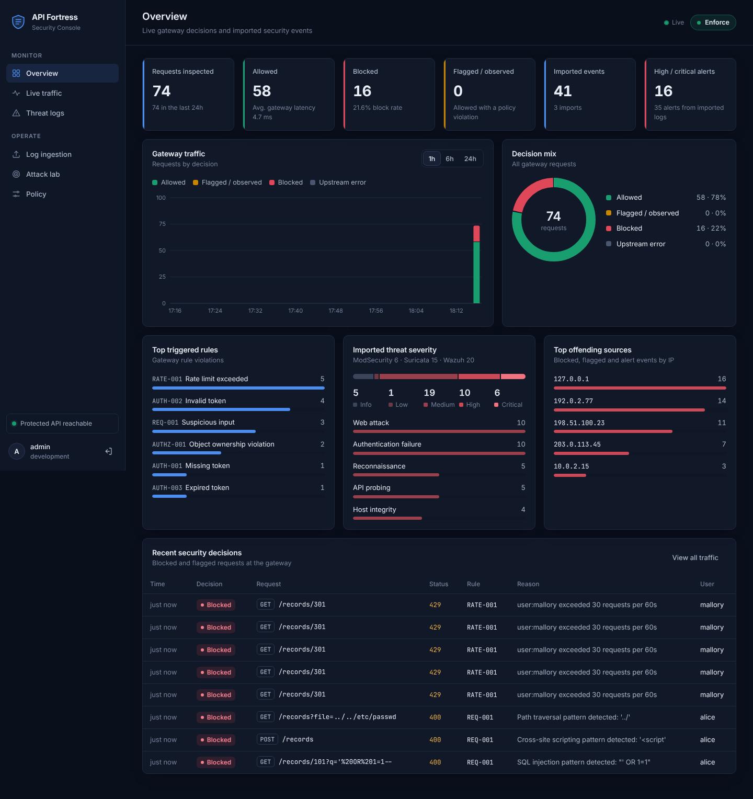

# API Fortress

A zero-trust API security gateway. It sits in front of an API, authenticates and
authorises every request, blocks abuse before it reaches the backend, analyses
real security logs from Wazuh, Suricata and ModSecurity, and shows everything in
a security console.



| Capability | What it does |
|---|---|
| **Live API protection** | Reverse proxy that validates JWTs, enforces object ownership (BOLA), rate-limits, inspects input and blocks violations |
| **Operating modes** | Learning, Monitor and Enforce, switchable at runtime from the dashboard |
| **Real-log analysis** | Imports Wazuh alerts, Suricata EVE JSON and ModSecurity audit logs, normalises them and applies documented detection rules |
| **Security console** | Login-protected dashboard with live traffic, threat logs, ingestion, an attack lab and policy controls |
| **Evidence** | 72 automated tests, an in-dashboard attack lab, and a CLI attack simulator |

---

## 1. Run it on your laptop (Windows, step by step)

Tested on Windows 10/11. Takes about five minutes.

### 1.1 Install Python (once)

1. Download **Python 3.12** from <https://www.python.org/downloads/>.
2. Run the installer and **tick "Add python.exe to PATH"** on the first screen, then click *Install Now*.
3. Open a new *Command Prompt* and check: `python --version` (should print 3.10 or newer).

### 1.2 Open the project in VS Code

1. Unzip `api-fortress.zip` somewhere simple, e.g. `C:\Projects\api-fortress`.
2. In VS Code: **File → Open Folder…** → select the `api-fortress` folder.
3. Accept the prompt to install the recommended *Python* extension.

### 1.3 Set up (once)

In VS Code open a terminal (**Terminal → New Terminal**) and run:

```bat
setup.bat
```

This creates a virtual environment in `.venv`, installs dependencies, creates
your `.env` file from `.env.example`, and runs the test suite. You should see
`72 passed`.

> If VS Code asks *"We noticed a new environment has been created. Do you want to select it?"*, click **Yes**.

### 1.4 Start

```bat
start.bat
```

Your browser opens **http://127.0.0.1:8000/dashboard**. Sign in with:

| Username | Password |
|---|---|
| `admin` | `ChangeMe!2026` (set in `.env` → `ADMIN_PASSWORD`) |

Press **Ctrl+C** in the terminal to stop.

You can also press **F5** in VS Code and choose *"API Fortress: run everything"*.

### macOS / Linux

```bash
chmod +x setup.sh start.sh
./setup.sh
./start.sh
```

### Manual setup (any OS)

```bash
python -m venv .venv
# Windows: .venv\Scripts\activate      macOS/Linux: source .venv/bin/activate
pip install -r requirements.txt
copy .env.example .env                 # macOS/Linux: cp .env.example .env
python run_local.py
```

---

## 2. A five-minute demonstration

1. **Log ingestion** → upload `data/sample_logs/wazuh_alerts.json`, then `suricata_eve.json` and `modsecurity_audit.json`. Each import shows parsed, skipped and failed counts and the number of alerts. (Replace these with your own lab logs; see [docs/INTEGRATION.md](docs/INTEGRATION.md).)
2. **Threat logs** → filter by source or severity, click a row to see which detection rules matched and why, plus the raw record.
3. **Attack lab** → *Run all scenarios*. Each scenario sends real requests through the gateway:
   - Alice reads her own record → **200**
   - Alice reads Bob's record → **403 AUTHZ-001** (BOLA blocked)
   - No / forged / `alg=none` / expired token → **401 AUTH-00x**
   - SQL injection, XSS, path traversal → **400 REQ-001**
   - Request flood → **429 RATE-001**
4. **Policy** → switch to **Monitor** and rerun the BOLA scenario: the request is *flagged* and forwarded, and Bob's record comes back. This shows the backend really is vulnerable and the gateway is what protects it. Switch back to **Enforce**.
5. **Overview** → live charts update every few seconds.

From a terminal you can produce the same evidence:

```bash
python scripts/simulate_attacks.py            # against http://127.0.0.1:8000
python -m pytest -v                           # full automated test suite
```

### Calling the API yourself

```bash
# 1. log in through the gateway
curl -s -X POST http://127.0.0.1:8000/auth/login -H "Content-Type: application/json" ^
     -d "{\"username\":\"alice\",\"password\":\"Alice@123\"}"

# 2. use the token
curl -i http://127.0.0.1:8000/records/101 -H "Authorization: Bearer <token>"   # 200
curl -i http://127.0.0.1:8000/records/202 -H "Authorization: Bearer <token>"   # 403
```

(On macOS/Linux replace `^` with `\`.)

Demo API users: `alice / Alice@123`, `bob / Bob@123`, `mallory / Mallory@123`, `admin / Admin@123` (role admin).
Records: 101, 102 (Alice) · 201, 202 (Bob) · 301 (Mallory).

---

## 3. How it works

```
                    ┌──────────────────────────── API Fortress gateway (:8000) ───────────────────────────┐
 client ──HTTP──▶   │ size check → input inspection → JWT auth → rate limit → ownership check → decision │ ──▶ protected API (:9000)
                    │                     every decision is written to the event store                   │      (rejects anything without
                    └───────────────────────────────────────────┬────────────────────────────────────────┘       the gateway secret)
                                                                │
 Wazuh / Suricata / ModSecurity logs ──▶ parser → normaliser → detection rules ──▶ event store ──▶ dashboard (/dashboard)
```

| Rule | Check | Status | Blocks in |
|---|---|---|---|
| AUTH-001…004 | Missing, invalid, expired token, wrong issuer/audience | 401 | every mode |
| AUTHZ-001 | Token subject does not own the requested object | 403 | Enforce |
| RATE-001 | More than *N* requests per window | 429 | Enforce |
| REQ-001 | SQLi / XSS / traversal / command injection pattern | 400 | Enforce |
| REQ-002 | Body larger than `MAX_BODY_BYTES` | 413 | every mode |

Imported events are classified with rules DET-001…DET-008 (web attack, authentication
failure, reconnaissance, API probing, repeated source, host integrity, etc.). Imported
alerts are always stored with `origin=imported` and are never counted as requests
the gateway blocked.

Full details: [docs/ARCHITECTURE.md](docs/ARCHITECTURE.md).

---

## 4. Project layout

```
api-fortress/
├── app/                    Gateway
│   ├── main.py             FastAPI app, routes, security headers
│   ├── gateway.py          Request evaluation pipeline and decisions
│   ├── proxy.py            Reverse proxy (HTTPX), header hygiene, timeouts
│   ├── security/           jwt_auth, authorization (BOLA), rate_limit, inspection
│   ├── log_parser.py       Wazuh / Suricata / ModSecurity parsing and normalisation
│   ├── detection.py        Detection rules for imported events
│   ├── ingest.py           Parse → classify → store
│   ├── events.py           Event store queries for the dashboard
│   ├── admin.py            Admin API (/admin/api/*)
│   ├── simulator.py        Attack lab scenarios
│   ├── runtime.py          Persisted mode and rate-limit state
│   ├── models.py / database.py / config.py
├── demo_api/               Protected API with an intentional BOLA flaw
├── dashboard/              Security console (HTML/CSS/JS, no build step)
├── tests/                  72 pytest tests
├── data/sample_logs/       Sample logs in the real tool formats
├── scripts/                simulate_attacks.py, ship_logs.py, generate_secrets.py
├── deploy/                 Container entrypoint, Caddy (HTTPS) config
├── Dockerfile, docker-compose.yml, render.yaml
├── run_local.py            Starts gateway + demo API together
└── setup.bat / start.bat / setup.sh / start.sh
```

---

## 5. Deploying online

Three tested paths, all described step by step in **[docs/DEPLOYMENT.md](docs/DEPLOYMENT.md)**:

1. **Render (free, easiest)** — push to GitHub, create a Blueprint from `render.yaml`, get an HTTPS URL.
2. **VPS with Docker Compose + automatic HTTPS** — backend on a private network, Caddy with Let's Encrypt.
3. **Share from your laptop** — a temporary public URL via a tunnel, for a quick demo.

Before any online deployment: run `python scripts/generate_secrets.py`, set
`APP_ENV=production`, and use the generated values. The gateway refuses to start
in production with default or weak secrets.

## 6. Integrating real logs and your own API

See **[docs/INTEGRATION.md](docs/INTEGRATION.md)** for:

- exporting logs from Wazuh, Suricata and ModSecurity and importing them,
- continuous shipping with `scripts/ship_logs.py`,
- putting the gateway in front of a different API.

## 7. Known limitations

- The rate limiter is in-memory: counters reset on restart and are per process. Run one worker, or swap in Redis to scale out.
- Input inspection uses signature patterns; it is defence in depth, not a substitute for parameterised queries and output encoding in the backend.
- Learning mode records endpoint profiles; it does not automatically generate policies.
- Detection rules flag events that match indicators. A match is not proof that an attack succeeded. Accuracy, precision or recall are only meaningful against labelled data.
- The demo API's BOLA flaw is intentional so the gateway's protection can be demonstrated.
